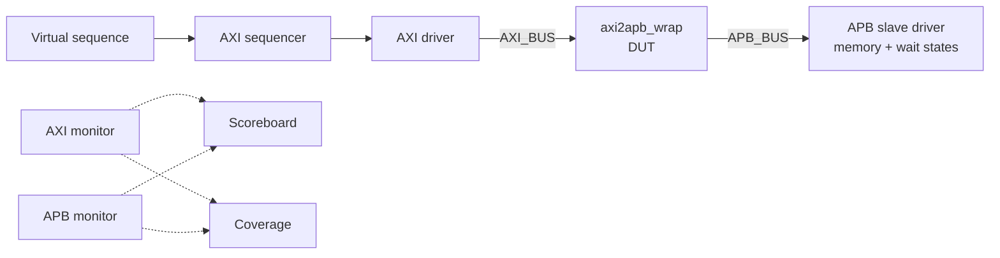

# AXI4-to-APB Bridge: Dual-Agent UVM Verification

UVM verification environment for an AXI4-to-APB bridge, using a **dual-agent** architecture: an active **AXI master agent** drives the bridge and a reactive **APB slave agent** answers it. A scoreboard checks every AXI transaction against the APB transfer it produces.

The first milestone is a **directed test** for single-beat reads and writes. Simulator: **Synopsys VCS** with UVM 1.2.

---

## Architecture



| Component | Role |
|-----------|------|
| **AXI agent** | Active master: sequencer, driver, monitor. Drives AW/W together, then collects B or R. |
| **APB agent** | Reactive slave: its driver answers `PENABLE` in the same cycle (the bridge samples `PREADY` combinationally). Has its own memory and configurable wait states. No sequencer is needed. |
| **Scoreboard** | Pairs each completed AXI transaction with the matching APB transfer, in order. |
| **Coverage** | Direction, address range, data corner values, response, APB wait cycles. |
| **Virtual sequencer** | Gives virtual sequences access to the AXI sequencer and to the APB slave config. |

### What the scoreboard checks

- AXI address and data equal APB `PADDR` and `PWDATA` / `PRDATA`
- `BRESP` / `RRESP` is OKAY, and no `PSLVERR`
- Response ID equals request ID, and `RLAST` is set on reads
- Read data equals the last value written to that address
- No unmatched or leftover transactions at the end of the test

### Timing methodology

All testbench signals are driven on the **falling clock edge** and ready/valid flags are sampled there too. The DUT only changes its outputs after a rising edge, so this is race-free in any simulator.

---

## Directory structure

```
.
├── Makefile
├── build.flist          # include dirs + source order
├── rtl/                 # DUT and dependent RTL
├── tb/                  # tb_top.sv, AXI_BUS and APB_BUS interfaces
├── uvm/                 # package, items, configs, agents, scoreboard, coverage, env
├── sequences/           # AXI sequences and virtual sequences
└── tests/               # UVM tests
```

`uvm/axi_apb_pkg.sv` includes every file in `uvm/`, `sequences/` and `tests/`. Compile order is: interfaces, RTL, package, `tb_top`.

---

## Design under test

The bridge comes from the PULP platform (ETH Zurich / University of Bologna, Solderpad License 0.51).

| File | Description |
|------|-------------|
| `axi2apb.sv` | 32-bit AXI to 32-bit APB bridge (single-beat only) |
| `axi2apb_64_32.sv` | 64-bit AXI to 32-bit APB bridge with burst support |
| `axi2apb_wrap.sv` | Interface-based wrapper; selects the bridge from the data widths |
| `axi_*_buffer.sv`, `axi_single_slice.sv`, `fifo.sv` | Channel buffers (AW, AR, W, R, B) |

The testbench instantiates `axi2apb_wrap` with 32-bit AXI data, 32-bit address, 6-bit ID and 6-bit user width.

---

## Directed test

`axi_apb_directed_test` runs `axi_apb_directed_vseq`:

| # | Scenario |
|---|----------|
| T1 | Single write, read back |
| T2 | Four addresses, read back in a different order |
| T3 | Overwrite the same address |
| T4 | Data patterns: `0x0`, `0xFFFFFFFF`, `0xAAAAAAAA`, `0x55555555` |
| T5 | Lowest (`0x0`) and highest (`0xFFFFFFFC`) word address |
| T6 | APB wait states of 1, 2 and 5 |
| T7 | `BREADY` / `RREADY` back-pressure (6-cycle delay) |
| T8 | Read of a register preloaded in the APB slave |
| T9 | Back-to-back mixed writes and reads |
| T10 | Maximum ID value (`0x3F`) |

---

## Running

Requirements: Synopsys VCS (with `-ntb_opts uvm-1.2`), and optionally DVE and URG for waveforms and coverage. Run all commands from the repository root.

```bash
make compile TEST=axi_apb_directed_test     # compile
make sim     TEST=axi_apb_directed_test     # simulate
make run                                    # compile + simulate (default test)
make gui                                    # open waveform in DVE
make cov                                    # merge coverage with URG
make clean                                  # remove this test's build
make allclean                               # remove everything in ./out
```

Optional settings: `SEED=5`, `VERBOSITY=UVM_HIGH`, `WAVE=0`, `TIME_OUT=<time>`.

Output goes to `out/build_<TEST>/`:

```
simv, simv.daidir, simv.vdb, csrc/      # build
compile.log                             # compile log
log_build_<TEST>.log                    # simulation log
waveform.vpd                            # waveform
```

A passing run prints `*** TEST PASSED ***` in the log.

### Adding a test

1. Create `tests/axi_apb_<name>_test.sv` (extend `axi_apb_base_test`).
2. Add an `` `include `` line for it in `uvm/axi_apb_pkg.sv`.
3. Run with `make run TEST=axi_apb_<name>_test`.

---

## Results

| Test | Seed | Status |
|------|------|--------|
| `axi_apb_directed_test` | 1 | _fill in after your run_ |

---

## Design notes found during review

These come from reading the RTL and are not checked by the current test:

- `axi2apb.sv` handles **single beats only** (`AWLEN` / `ARLEN` must be 0).
- `WSTRB` is ignored: partial-byte writes write the whole word.
- `PSLVERR` is not mapped back to `BRESP` / `RRESP`; the response is always OKAY.
- `PSEL` is tied high, so there is no separate APB setup phase before `PENABLE`.
- The state machines have no default `NS = CS;`, which can infer latches in synthesis.

---

## Roadmap

- Random test with constrained-random traffic and wait states
- Concurrent read and write traffic (separate read and write sequencers)
- Burst tests for `axi2apb_64_32`
- `PSLVERR` / error-response tests (once the RTL supports them)
- Coverage closure and a regression script

---

## License

The RTL is from the PULP platform under the Solderpad Hardware License v0.51 (see headers in `rtl/`). Add your own license for the verification code.
